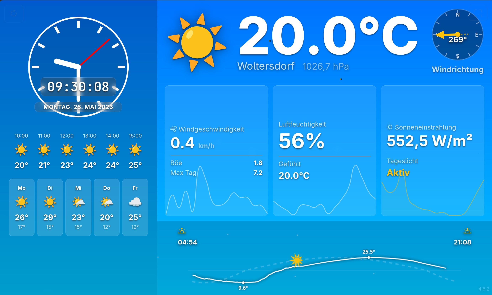

# Wetter & Clock Dashboard (wetter)

A single-page weather station and wall-clock dashboard designed for portrait orientation displays (e.g., wall-mounted OLED tablets in 9:16 aspect ratio). 

This repository was generated as part of a vibe coding experiment using the `gemini` and `antigravity` agentic CLI toolchains.

A production instance is hosted at [wetter.kwnetzwelt.net](https://wetter.kwnetzwelt.net).



---

## Technical Features

### UI & Layout (Portrait Optimization)
* **Layout Grid**: Split vertically into two columns:
  * **Left Column (32vw)**: Houses the clock complications (analog SVG face, digital JetBrains Mono font, and localized date/calendar week strings) and a horizontal weather forecast carousel.
  * **Right Column (68vw)**: Houses current weather conditions, an SVG wind-bearing compass, granular metric cards, and the sun path tracker.
* **Atmospheric Visuals**: Maps CSS linear gradients to weather states (clear, partly cloudy, cloudy, twilight, clear night, cloudy night, rain, storm) coupled with an HTML5 canvas-rendered particle system simulating weather conditions (snow, rain, stars).
* **OLED Prevention**: Utilizes deep-black `#000000` backgrounds during nighttime cycles to reduce power usage and prevent OLED burn-in. Includes the HTML5 Screen Wake Lock API to prevent display sleep.

### Backend & Integrations
* **Dual Data Providers**:
  * **Home Assistant**: Integrates via the REST API using a Long-Lived Access Token to retrieve state details for a primary `weather` entity and/or granular sensor entities.
  * **Open-Meteo API**: Functions as a fallback weather data provider using standard geographical coordinates.
* **SVG Wind Compass**: Rotates dynamically using CSS transitions based on degrees fetched from the data providers.
* **Data Visualization**: Employs Chart.js to render compact sparkline trends for wind speed, humidity, and solar radiation directly inside standard layout cards.
* **Solar Path Tracking**: Draws sunrise, sunset, and real-time sun positions along a scalable quadratic Bézier curve on an HTML5 canvas.
* **Auto-Recovery**: Triggers client-side page reload if the backing ASP.NET Core server restarts, and refreshes API weather data on a 10-minute interval.

---

## Architecture & Stack

* **Runtime**: .NET 9.0 (ASP.NET Core MVC / Razor Pages)
* **Client-side**: HTML5 Canvas, SVG, ES6 JavaScript, jQuery, Bootstrap 5, Chart.js v4
* **Deployment**: Multi-stage `Dockerfile` and `docker-compose.yml`

---

## Configuration

Settings are parsed from `appsettings.json` or overridden via environment variables under the `WeatherSettings` section.

### appsettings.json
```json
"WeatherSettings": {
  "Latitude": 52.5200,
  "Longitude": 13.4050,
  "CityName": "Berlin",
  "Language": "de-DE",
  "ClockType": "analog",
  "UseHomeAssistant": false,
  "HomeAssistantUrl": "http://192.168.1.100:8123",
  "HomeAssistantToken": "YOUR_LONG_LIVED_ACCESS_TOKEN_HERE",
  "HomeAssistantEntityId": "weather.home",
  "HomeAssistantRainEntityId": "sensor.gw3000a_hourly_rain"
}
```

### Environment Variables

| Variable | Target Property | Default |
| :--- | :--- | :--- |
| `LATITUDE` | `WeatherSettings:Latitude` | `52.5200` |
| `LONGITUDE` | `WeatherSettings:Longitude` | `13.4050` |
| `CITY_NAME` | `WeatherSettings:CityName` | `Berlin` |
| `TIMEZONE` | `TZ` (Docker container timezone) | `Europe/Berlin` |
| `HA_TOKEN` | `WeatherSettings:HomeAssistantToken` | `""` |
| `HA_ENTITY_ID` | `WeatherSettings:HomeAssistantEntityId` | `weather.home` |
| `HA_TEMP_SENSOR` | `WeatherSettings:HomeAssistantTempEntityId` | `null` |
| `HA_HUMIDITY_SENSOR` | `WeatherSettings:HomeAssistantHumidityEntityId` | `null` |
| `HA_PRESSURE_SENSOR` | `WeatherSettings:HomeAssistantPressureEntityId` | `null` |
| `HA_WIND_SPEED_SENSOR` | `WeatherSettings:HomeAssistantWindSpeedEntityId` | `null` |
| `HA_WIND_DIRECTION_SENSOR` | `WeatherSettings:HomeAssistantWindDirectionEntityId` | `null` |
| `HA_WIND_GUST_SENSOR` | `WeatherSettings:HomeAssistantWindGustEntityId` | `null` |
| `HA_MAX_DAILY_GUST_SENSOR` | `WeatherSettings:HomeAssistantMaxDailyGustEntityId` | `null` |
| `HA_SOLAR_RADIATION_SENSOR` | `WeatherSettings:HomeAssistantSolarRadiationEntityId` | `null` |
| `HA_RAIN_SENSOR` | `WeatherSettings:HomeAssistantRainEntityId` | `null` |

---

## Deployment & Run Commands

### Docker Compose
1. Populate local environment variables in a `.env` file if mapping custom coordinates or Home Assistant integrations.
2. Build and launch the container in the background:
   ```bash
   ./build.sh
   ```
   *(Or run: `docker compose up -d --build`)*
3. Access the application on port `8080` (e.g., `http://localhost:8080`).

### Native Execution
1. Build the solution:
   ```bash
   dotnet build wetter.sln
   ```
2. Start the web application:
   ```bash
   dotnet run --project wetter.Web/wetter.Web.csproj
   ```
3. Execute unit tests:
   ```bash
   dotnet test wetter.Tests/wetter.Tests.csproj
   ```
